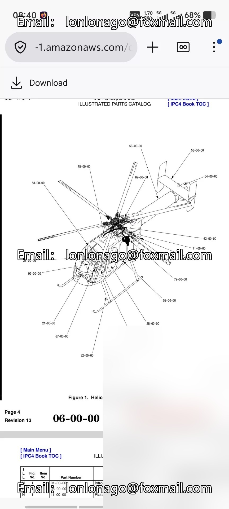
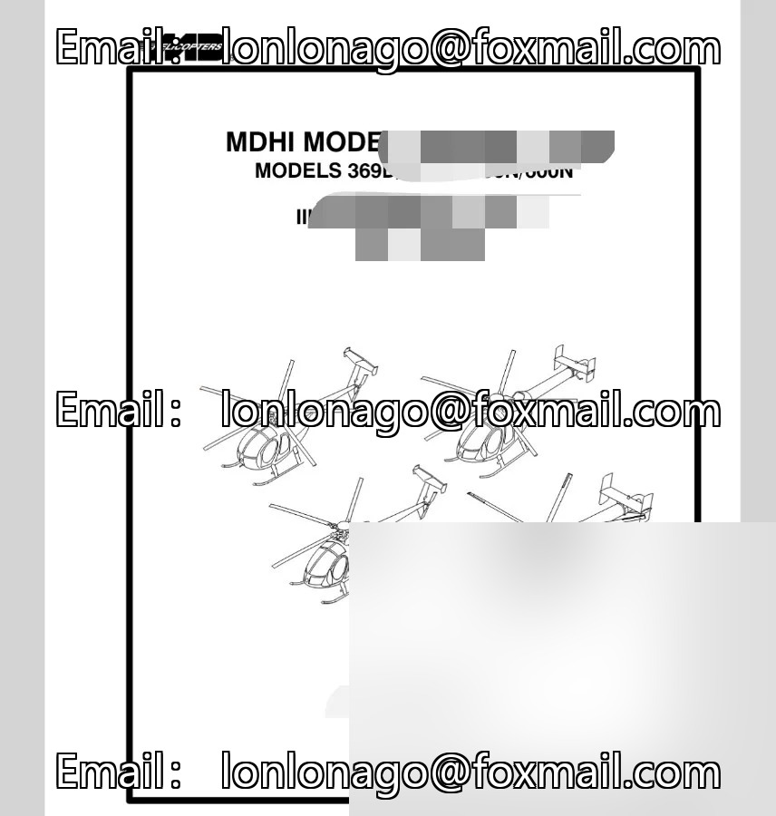
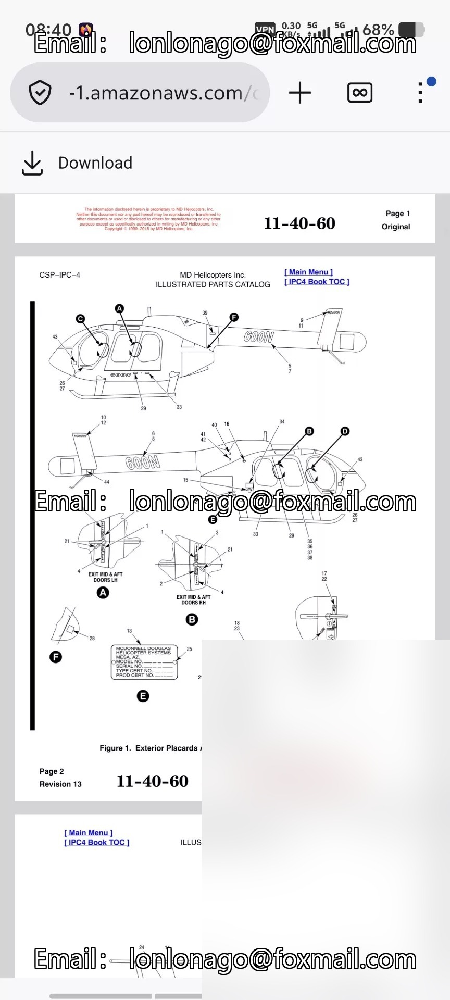
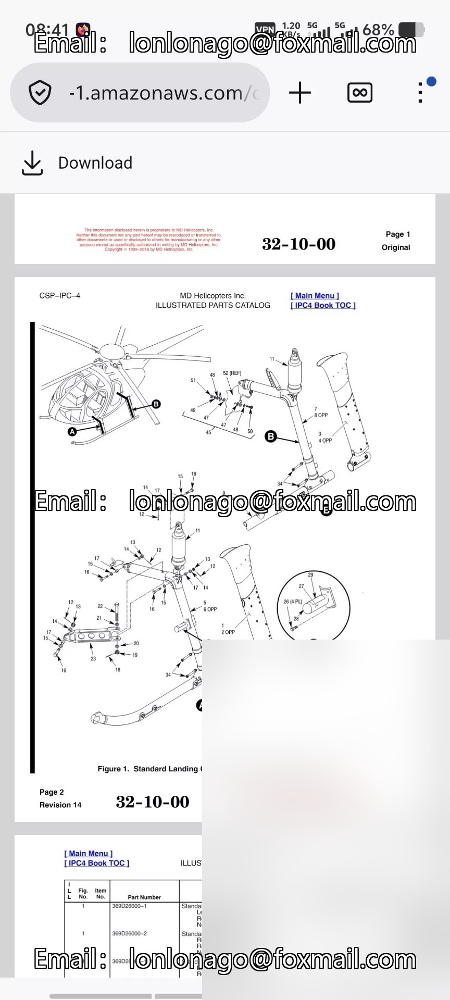

# MD Helicopter part catalog

## Body

MD Helicopters Helicopter Parts Catalog
Over 2,100 pages.
Document nature: 《Illustrated Parts Catalog》(Illustrated Parts Catalog)
Covers a classic series produced by MDHI (MD Helicopters Inc.). The parts catalog contains multiple specific models, all originating from the famous historical Hughes 500/MDT 500 series, typically nicknamed as "little bird."
Applicable for model 369D/E/FF - 500N/600N
containing detailed drawings for various helicopter components, systems, structures, etc., suitable for research on aviation maintenance, training, and technical reference.
Can be directly requested to shoot, contact for questions privately.

The catalog covers MD Helicopters helicopter parts with multiple models, suitable for aviation maintenance, training and technical research.

<!-- AI_ENRICHED -->

## Images

## Payment

Here is a pay link on Stripe ( https://buy.stripe.com/3cs8yP7sY87d0vu9AB ). Please contact me lonlonago@foxmail.com after funding $89, and I will send you a complete data files , thank you!

